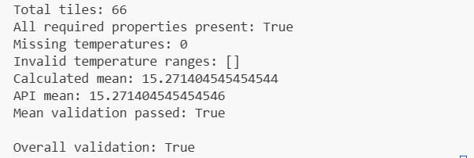
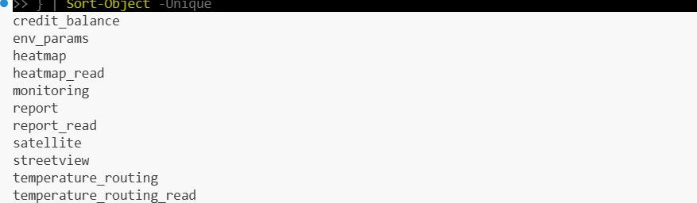
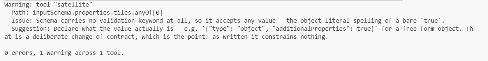

# FortyGuard Product Evaluation

## 1. Temperature Dashboard Evaluation

### 1.1 Initial Inspection

- Successfully logged into the Temperature Dashboard.
- Selected California during onboarding.
- The map opened with California highlighted.
- The sidebar provided three main options:
  - Create Heatmap
  - Find the Coolest Route
  - Demo Heatmaps
- A Selesious AI Agent promotional popup appeared.

### 1.2 Heatmap Configuration

The first heatmap was configured using the following options:

| Setting | Selected / Available Value |
|---|---|
| Location | San Francisco, California, USA |
| Shape | Circle |
| Selected area | 97.56 km² |
| Perimeter | 35.02 km |
| Available granularity | 100 × 100 m, 80 × 80 m, 60 × 60 m |
| Selected granularity | 100 × 100 m |
| Available time frames | Single Hour, Range of Hours, Single Day, Range of Days, Single Month |
| Selected time frame | Single Day |
| Date | November 10, 2026 |

**Interface observation:** The configuration interface used the label "Area of polygon" even when Circle was selected. This could be clarified to make the terminology consistent with the selected shape.

### 1.3 Heatmap Generation

**Result: Successful**

- Submitted the configured heatmap request.
- The dashboard successfully generated the heatmap.
- A coloured temperature grid appeared on the map.
- No visible error was encountered.
- Processing time was not recorded.
- Task queue behaviour was not investigated.

### 1.4 Heatmap Statistics and Information

The generated heatmap displayed the following statistics:

| Metric | Observed Value |
|---|---:|
| Maximum temperature | 60.25°F |
| Minimum temperature | 56.39°F |
| Mean temperature | 58.75°F |
| Standard deviation | 0.81 |
| Temperature range | 3.86°F |
| Total data points | 7,225 |

**Available visualizations:**
- Bar graph
- Normal distribution curve
- Box plot

**Additional metadata:**
- Heatmap type: Temperature Classification Map
- Granularity: 100 × 100 m
- Time frame: Single Day
- Date: November 10, 2026
- Time range: 12:00 AM–11:59 PM
- Heatmap ID and creation timestamp were available.
- The Accuracy Index described seven accuracy tiers.

**Open questions:**
- How are valid data points counted?
- Why does the generated area differ slightly from the initial estimate?
- Where is the assigned accuracy tier displayed?
- Is standard deviation expressed in °F?

These questions were not independently resolved during testing.

### 1.5 Map Controls and Visualization

The dashboard provided the following controls:

- Continuous and Classed colour modes
- Number of classes (12 in the tested configuration)
- Sequential, Diverging and Cyclic colour schemes
- Spectral colour ramp
- Temperature legend in °F and °C
- Individual temperature-range selection
- Time Series Simulation
- Heatmap and Polygon layers
- Opacity adjustment
- Download and Upload options

#### Continuous vs Classed Visualization

**Observed behaviour:**
- Initially selected Classed mode.
- Switched to Continuous mode for comparison.
- Classed mode displayed clearer distinctions between temperature ranges.
- Continuous mode displayed more gradual colour transitions.

**Observation:** Classed mode was easier to interpret when identifying distinct temperature zones, while Continuous mode provided a more gradual representation of temperature variation.

#### Temperature Unit Switching

**Tested:** Fahrenheit (°F) and Celsius (°C).

**Observed behaviour:**
- Temperature legend values updated according to the selected unit.
- Heatmap colours remained consistent.
- No visible change occurred in the spatial temperature distribution.

**Result:** Unit switching worked as expected and provided consistent visualization across both measurement systems.

#### Temperature Legend Filtering

**Observed behaviour:**
- Clicking "Unselect all" removed all temperature colours from the map.
- Selecting an individual temperature range displayed only the areas corresponding to that range.

**Result:** Worked as expected during testing.

**Usability observation:** This feature makes it easier to isolate and examine specific temperature ranges.

#### Time Series Simulation

**Result: Successful**

**Observed behaviour:**
- Enabling the feature displayed playback controls.
- A play button and timeline slider appeared.
- Temperature colours changed during playback.
- The displayed heatmap time progressed as the simulation ran.

**Usability observation:** The feature provides an interactive way to explore temperature variations over time instead of viewing only a static heatmap.

#### Layers and Opacity

**Heatmap Layer:**
- Turning it off made the temperature map disappear.
- Turning it on restored the temperature map.

**Polygon Layer:**
- Turning it on displayed the circular study-area boundary.
- Turning it off removed the boundary.

**Heatmap Opacity:**
- Decreasing opacity made the heatmap less visually prominent.
- Increasing opacity made the colours more prominent.

**Overall observation:** Layer visibility and opacity controls behaved intuitively and allowed independent control over map elements.

### 1.6 Environmental Parameters

#### Tile Capture Workflow

**Result: Successful**

Observed workflow:

1. Clicked "Start a Capture".
2. Dashboard prompted me to select a map tile.
3. Clicking the map dropped a pin.
4. A success message appeared: "Tile Data Captured and added to gallery."

**Result:** The selected tile's data was successfully captured and added to the gallery.

#### Direct Temperature Measures

| Parameter | Observed Value |
|---|---:|
| Heat Index | 59.72°F |
| Relative Humidity | 86.40% |
| Wet Bulb Globe Temperature | 57.52°F |

The dashboard also displayed associated ranges, risk classifications, conditions, and recommendations.

For example:
- Relative humidity above 81% was classified as Very High.
- The displayed wet-bulb globe temperature condition was Good conditions.

#### Temperature-Dependent Parameters

**Precipitation:**

| Metric | Observed Value |
|---|---:|
| Precipitation | 0 mm/hr |
| Displayed range | 0–0 mm/hr |
| Classification | No Rain |

**Observation:** The section displayed one precipitation metric during this test.

#### Air Quality

| Parameter | Measured Value | Classification |
|---|---:|---|
| O₃ (Ozone) | 19.12 µg/m³ | Good |
| SO₂ (Sulfur Dioxide) | 0.65 µg/m³ | Good |
| NO₂ (Nitrogen Dioxide) | 10.16 µg/m³ | Good |

#### Solar Irradiance

| Parameter | Value | Meaning |
|---|---:|---|
| GHI | 306.95 W/m² | Total solar radiation on a horizontal surface |
| DNI | 573.58 W/m² | Direct solar radiation perpendicular to the sun's rays |
| DHI | 56.32 W/m² | Scattered solar radiation received on a horizontal surface |

### 1.7 Dashboard Testing Summary

The following features were explored successfully:

- Heatmap generation and statistical summaries
- Continuous and Classed visualization modes
- Fahrenheit and Celsius switching
- Temperature legend filtering
- Time Series Simulation
- Heatmap and Polygon layer visibility
- Opacity adjustment
- Environmental tile capture and gallery
- Direct Temperature Measures
- Precipitation
- Air Quality
- Solar Irradiance

### 1.8 Dashboard Improvement Opportunities

Based on the observations, the following improvements could make the dashboard more user-friendly:

1. Clarify analytical metrics by providing explanations of their units, calculation methods, and interpretation.
2. Improve terminology consistency, particularly the area label when a circular shape is selected.
3. Provide clearer guidance about the Accuracy Index and where users can find the assigned accuracy tier.
4. Explain differences between initially estimated and generated area or perimeter values.

---

## 2. Temperature API Evaluation

### 2.1 Heatmap API – Functional Testing

**Test environment:** San Francisco, California, USA  
**Granularity:** 100 metres  
**Date:** November 10, 2026  
**Analytic type:** Temperature (`tcm`)

**Observed results:**

- Successfully submitted a heatmap generation request.
- Received HTTP 200.
- Successfully retrieved the completed asynchronous task.
- The API returned a GeoJSON FeatureCollection containing 66 polygon features.
- Each feature contained a tile identifier and average, minimum, and maximum temperature properties.
- The response also included aggregated temperature statistics.

### 2.2 API Response Validation

A separate Python script was developed to inspect and validate the returned GeoJSON data.

The validation covered:

- Total number of returned features.
- Presence of required temperature properties.
- Missing average-temperature values.
- Consistency of minimum, average, and maximum temperature values.
- Independent calculation of the mean temperature.

**Validation results:**

| Validation Check | Result |
|---|---|
| Total features | 66 |
| Required properties present | Passed |
| Missing average temperatures | 0 |
| Invalid temperature ranges | 0 |
| Independent mean calculation | Passed |
| Overall validation | Passed |

All individual tile temperature ranges satisfied:

`minimum ≤ average ≤ maximum`

The independently calculated mean across all 66 tiles matched the API-provided mean.

### 2.3 API Testing Conclusion

All performed structural and numerical validation checks passed.

The returned GeoJSON data was internally consistent for this test case. These checks verified the structure and numerical consistency of the response; they did not independently establish the real-world accuracy of the temperature measurements.

### 2.4 API Documentation Improvement Opportunities

During the evaluation, I identified areas where the developer documentation could be clearer:

1. Explain response fields, temperature units, and the calculation basis of statistical values.
2. Keep the Quickstart guide and individual endpoint examples consistent, particularly the polygon input structure.
3. Provide additional examples of error responses, asynchronous task failures, and polling behaviour.

---

## 3. FortyGuard Temperature MCP Evaluation

### 3.1 Testing Environment

**Tool used:** MCP Inspector CLI  
**Server:** FortyGuard Temperature MCP  
**Transport:** HTTP  
**Authentication:** Bearer authentication  
**Connection status:** Successful

I used MCP Inspector CLI to connect to the remote FortyGuard MCP server and inspect its available tools.

I chose the CLI approach for testing rather than integrating the server with an AI desktop client such as Claude Code, Cursor, or Codex.

### 3.2 MCP Tool Discovery

Successfully retrieved the live tool catalog using the `tools/list` method.

The server exposed 11 tools:

| No. | Tool Name |
|---:|---|
| 1 | `credit_balance` |
| 2 | `env_params` |
| 3 | `heatmap` |
| 4 | `heatmap_read` |
| 5 | `monitoring` |
| 6 | `report` |
| 7 | `report_read` |
| 8 | `satellite` |
| 9 | `streetview` |
| 10 | `temperature_routing` |
| 11 | `temperature_routing_read` |

**Observation:** The live server exposed 11 tools, whereas the introductory documentation I reviewed referred to 9 tools.

### 3.3 Read-Only Tool Execution

Successfully executed the `credit_balance` tool.

**Observed results:**

- Tool execution completed successfully.
- Returned status: `ok`.
- Returned the available credit balance.
- Reported latency of approximately 1.66 seconds.
- Credit cost: 0.

**Observation:** The tool returned a structured response and allowed me to verify that an MCP tool could be invoked successfully after establishing the connection.

### 3.4 MCP Schema Validation

Used MCP Inspector CLI with strict schema validation to inspect the available tool definitions.

**Validation results:**

| Validation Check | Result |
|---|---|
| Schema validation errors | 0 |
| Schema validation warnings | 1 |
| Tool associated with warning | `satellite` |
| Affected parameter | `tiles` |

**Warning details:**

The `satellite` tool's `tiles` input schema contains an `anyOf` branch without a validation keyword. This means that branch does not adequately constrain the accepted input values.

**Suggested improvement:** Define the intended input type and validation rules for the affected schema branch. For example, if it is intended to accept a free-form object, explicitly declare the object type and its permitted properties.

**Observation:** The warning did not prevent tool discovery or establish a connection failure. It identifies an opportunity to improve schema clarity and input validation.

### 3.5 MCP Testing Limitations

The MCP evaluation was limited to:

- Establishing a remote connection.
- Verifying Bearer authentication.
- Discovering the available tools.
- Executing the read-only `credit_balance` tool.
- Inspecting tool input schemas through strict validation.

I did not execute credit-consuming MCP operations or test the server through a separate AI desktop client.

### 3.6 MCP Evaluation Conclusion

The remote MCP connection and authentication worked successfully. I was able to discover all 11 available tools, execute the read-only `credit_balance` tool, and inspect the tool schemas.

Strict validation reported zero errors and one warning related to the `satellite` tool's `tiles` parameter.

Further functional testing of individual tools and integration with AI clients would be useful for a more comprehensive evaluation.

---

## 4. Supporting Evidence

The following screenshots provide supporting evidence of the technical evaluation:

### API Validation

Shows the Python validation results for the returned GeoJSON data.

### MCP Tool Discovery

Shows the 11 tools discovered through MCP Inspector CLI.

### MCP Schema Validation

Shows the strict schema validation summary, including zero errors and one warning.
